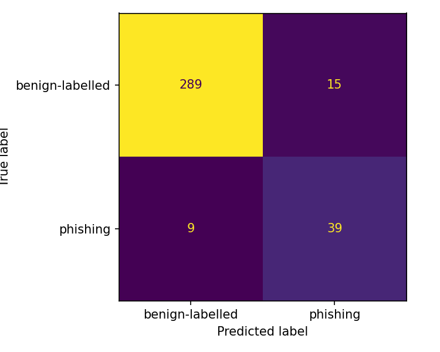
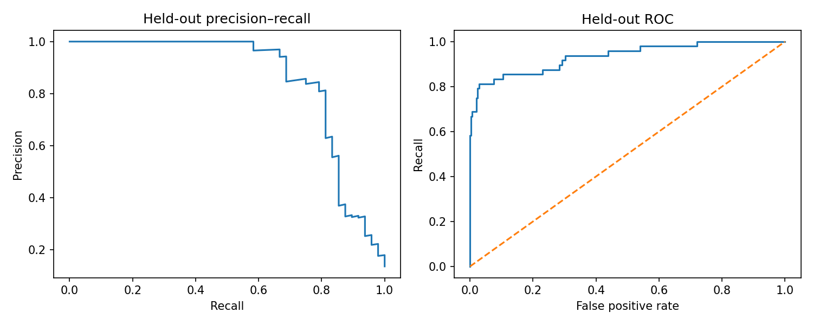
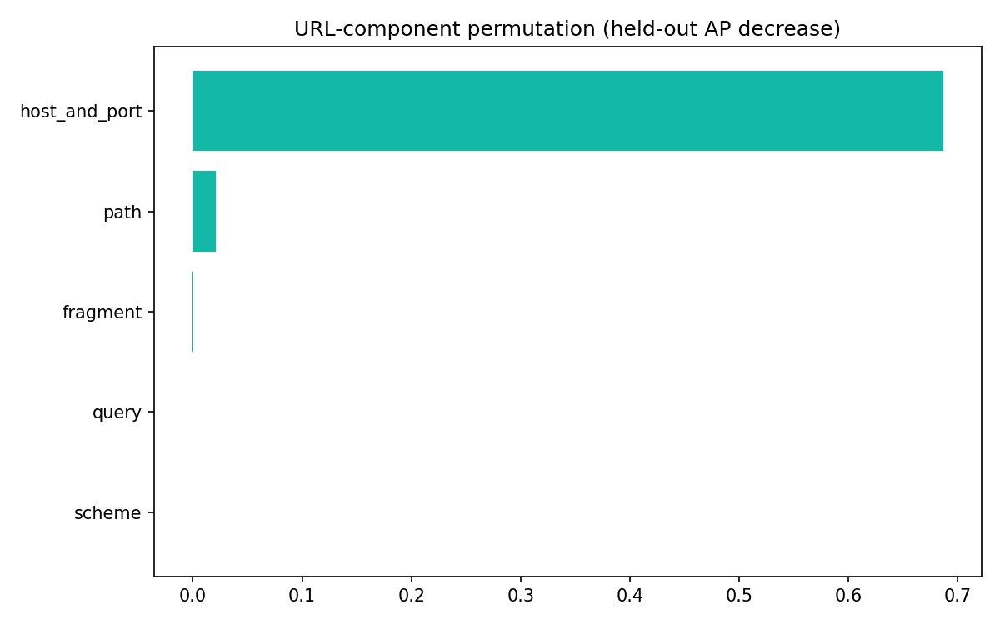
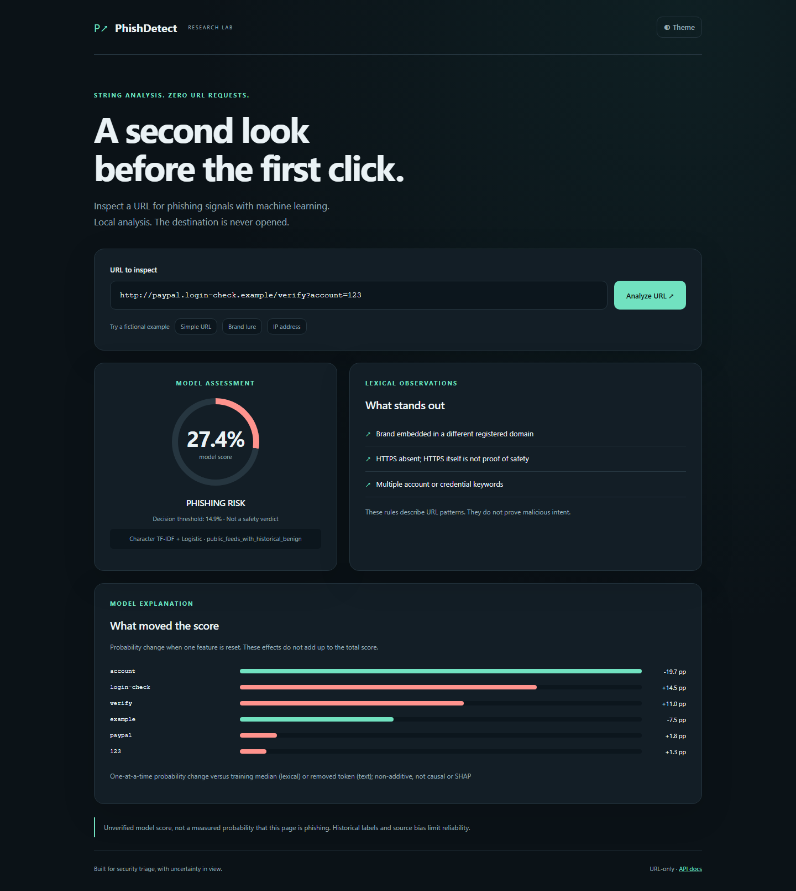
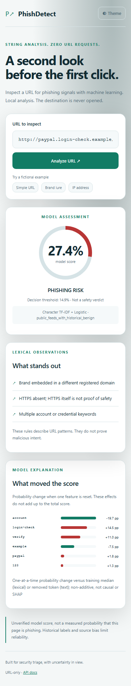
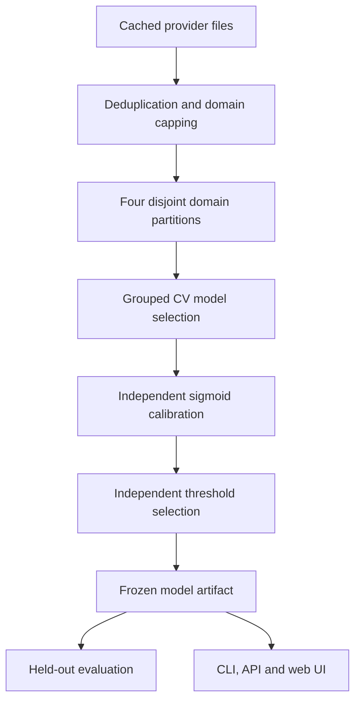

# PhishDetect - URL-only phishing triage

A local machine-learning project for Task 01, Team TechWave Developers. The CLI, FastAPI service and responsive web UI score URL strings and explain model influences. Submitted URLs are never opened, fetched, resolved or stored by the application. No external reputation service is consulted.

**Research prototype with known false positives and missed phishing. A model score is not a verified probability that a page is dangerous.**

## Results from the recorded dataset

<!-- RESULTS:START -->
**Dataset: `public_feeds_with_historical_benign` — 1800 URLs.**

**Public-source study only; inherited historical labels, weak Tranco labels and source bias prevent real-world accuracy claims.**

Dataset SHA-256: `95a2c627d99fb4a4aaab79171e7c4d346e59f9355b731469f4f0277ee0de41b0`.

| Model | Grouped CV AP | Test precision | Test recall | Test F1 | Test AP | Test ROC-AUC | Threshold |
|---|---:|---:|---:|---:|---:|---:|---:|
| Logistic Regression | 0.7861 | 0.6418 | 0.8958 | 0.7478 | 0.9252 | 0.9807 | 0.236635 |
| Random Forest | 0.7927 | 0.4071 | 0.9583 | 0.5714 | 0.8475 | 0.9503 | 0.030520 |
| Gradient Boosting | 0.7849 | 0.5263 | 0.8333 | 0.6452 | 0.8407 | 0.9441 | 0.097529 |
| Character TF-IDF + Logistic | 0.9215 | 0.7222 | 0.8125 | 0.7647 | 0.8562 | 0.9346 | 0.148607 |
| XGBoost | 0.7772 | 0.4598 | 0.8333 | 0.5926 | 0.8375 | 0.9314 | 0.059592 |

Selected by training-domain CV AP: **Character TF-IDF + Logistic**. Test FPR: **0.0493**. Descriptive test FPR at 90% recall: **0.2928**. Brier score: **0.0448**.

The chosen threshold achieved recall **0.9286** on threshold-tuning domains and **0.8125** on test domains. The tuning target is not a guarantee on unseen domains.

Confusion matrix (rows: true 0/1; columns: predicted 0/1): `[[289, 15], [9, 39]]`.

| Partition | Rows | Registered domains | Phishing |
|---|---:|---:|---:|
| fit | 935 | 869 | 170 |
| calibration | 229 | 218 | 40 |
| threshold | 284 | 272 | 42 |
| test | 352 | 340 | 48 |

Cross-partition domain overlap: **0**. CV folds: **5**.

Numbers are rounded for display; outputs/metrics.json contains full precision. No test labels were used for model or deployment-threshold selection.
<!-- RESULTS:END -->

PR-AUC is average precision (AP), not trapezoidal integration. Test FPR at 90% recall is a descriptive ROC statistic, not the app's frozen operating threshold. Threshold selection does not guarantee the same recall on unseen domains.





## What changed after real usage

The original study used 300 phishing URLs and 300 Tranco-derived homepages. It wrongly flagged normal article and video links. Homepages were poor representatives of legitimate web use; scheme formatting was also a shortcut. The previous high scores did not establish practical reliability.

The revised dataset adds historical legitimate-labelled deep links, caps each historical domain at five pool entries, and includes five legitimate examples per phishing example. Models receive a **scheme-neutral representation**: HTTP, HTTPS and omitted protocol produce identical model inputs. HTTPS remains a human-readable observation, separate from model evidence.

The YouTube and Westeros examples supplied during development are checked by `scripts/check_regressions.py`. Their entire registered domains are excluded from every dataset partition in the recorded build. There is no prediction-time domain whitelist. These examples influenced development, so their success is a regression check, **not an unbiased evaluation**. Exact scores and the dataset hash are saved in `outputs/regression_examples.json`.

## Start the app

For the already installed Windows project, double-click **Start_PhishDetect.cmd** and keep its console open. Then open <http://127.0.0.1:8000/>. After changing the code or trained model, stop the old server with Ctrl+C and launch again; refreshing alone does not reload a model already in memory.

For a clean setup (Python 3.12 recommended, minimum 3.11):

```bash
python -m venv .venv
# Windows PowerShell:
.venv/Scripts/Activate.ps1
# macOS/Linux: source .venv/bin/activate
python -m pip install -r requirements.txt
python -m pip install -r requirements-optional.txt  # optional XGBoost
python tasks.py data --exclude-domain youtube.com --exclude-domain westeros.org
python tasks.py train
python tasks.py test
python scripts/check_regressions.py
python tasks.py serve
```

The portable runner works without GNU Make. With Make installed, `make data`, `make train`, `make test`, and `make serve` call the same runner. For the exact diagnostic-domain exclusion, use the explicit data command above. Model/data seeds are fixed, but changing provider bytes can change results.

Offline synthetic demo: `python tasks.py data --synthetic --limit 600`, then train. Synthetic results are explicitly labelled. `python generate_data.py` remains supported and also writes provenance. `--roots-only` reproduces the limited historical roots-only builder; it is not the corrected default. `python tasks.py train --quick` uses fewer CV folds and smaller trees, recorded in metrics.

```bash
python predict.py "https://example.com/article?id=123"
python predict.py --json "https://example.com/"
python predict.py  # interactive
```

## Interface and API




The UI displays model score, verdict, actual decision threshold, source mode, heuristic warnings and non-additive probability changes. Themes follow system preference with a manual override. URLs are rendered as inert text, and a lower score is never labelled a safety guarantee.

`GET /health` reports model availability. `POST /predict` accepts a JSON `url` string up to 8,192 characters. Invalid input returns 422; missing models return 503. Schema: <http://127.0.0.1:8000/docs>.

```bash
curl -X POST http://127.0.0.1:8000/predict -H "Content-Type: application/json" -d '{"url":"https://example.com/article?id=123"}'
```

Response fields include `probability` (a calibrated study-model score, not live verified risk), `verdict`, `threshold`, `red_flags`, `contributions`, `model`, `dataset_mode`, `dataset_sha256`, and `notice`. Only load trusted joblib files: they use pickle. `PHISHDETECT_MODEL` selects another local model for the API.

Generate browser evidence with `python -m playwright install chromium` then `python tasks.py screenshots --in-process`. This routes actual browser HTTP requests to the real FastAPI app through TestClient, not mocked predictions. It checks JavaScript errors and horizontal overflow at 1440px and 390px. To test a running TCP server instead, omit `--in-process`. `--channel chrome` or `--executable-path PATH` can use an existing Chromium browser. Screenshot transport, browser version and dataset hash are recorded in `outputs/screenshots.json`.

## Architecture



| Module | Responsibility |
|---|---|
| `dataset.py` | Provider files, cached bytes, label provenance, pool balancing and domain exclusions |
| `features.py` | Defensive parsing, offline PSL, 29 lexical observations and scheme-neutral model inputs |
| `training.py` | Grouped CV, calibration, threshold selection, metrics, plots and errors |
| `inference.py` | Shared model inference and local explanations |
| `api.py`, `static/` | FastAPI and responsive UI |
| `tests/`, `scripts/` | Regression checks, tiny training, API tests and reproducible evidence |

Package modules live under `src/phishdetect/`. Root entry points preserve the original commands.

## Sources and data policy

- [OpenPhish Community Feed](https://openphish.com/phishing_feeds.html): phishing strings, optionally supplemented by [PhishTank](https://phishtank.net/developer_info.php) when `PHISHTANK_API_KEY` is set.
- [Tranco](https://tranco-list.eu/): ranked domains converted to HTTPS root strings. Ranking does not verify a page's safety or protocol; these are weak negatives.
- [Faizan's historical URL-classification corpus](https://github.com/faizann24/Using-machine-learning-to-detect-malicious-URLs): **only entries labelled `good`** are used as additional negatives. `bad` labels are not treated as phishing ground truth. These inherited labels are old and not live-verified. Downloaded source bytes remain local and are excluded from Git; do not assume redistribution rights for upstream data.

Default ingestion samples up to 50,000 historical good entries, caps them at five per registered domain, and removes exact duplicates, contradictory exact labels, malformed/oversized strings, excluded diagnostic domains, and negatives sharing a phishing-labelled domain. That last exclusion changes the study population. At the current positive-source size, the selected negatives are four historical entries plus one Tranco root per phishing entry. No URL paths are fabricated.

Only provider dataset endpoints are fetched, never candidate destinations. Caches are reused unless `--refresh` is supplied. Provenance records provider hashes, cache timestamps, class/source counts, URL-shape counts, exclusions and the exact CSV SHA-256. Cached sources may be stale. If required sources cannot be loaded, the explicit synthetic fallback warns and records its mode; no synthetic/real mixture is called real data.

## Evaluation and explanations

The offline bundled Public Suffix List (including private suffixes) defines registered-domain groups. Different paths and subdomains of the same registered domain stay together; IPs are grouped by address. Four partitions are approximately 51% fit, 13% calibration, 16% threshold tuning and 20% test; actual sizes vary with groups.

Five-fold stratified grouped CV on fitting domains chooses between two light hyperparameter candidates for each model, using AP. Scalers and TF-IDF vocabularies fit inside each CV fold. Compared models: Logistic Regression, Random Forest, Gradient Boosting, character TF-IDF + Logistic Regression, and optional XGBoost. The winner is frozen by CV AP before evaluating test scores.

A frozen fitted estimator is sigmoid-calibrated on separate calibration domains. A separate threshold partition chooses maximum precision subject to at least 90% recall (ties: largest threshold). The held-out test domains do not tune either model or threshold. Deployment uses that frozen artifact, not a refit on test data. The scheme-neutral representation is used consistently by training, CLI and API.

Global importance measures held-out AP decrease under three permutations. Lexical models permute individual features; character models permute URL component families. Local bars reset one lexical feature to its training median or remove one token for text models. These effects are non-additive, may create unrealistic feature combinations, and are not SHAP values or causal explanations. Red flags are independent heuristics. Brand matching is not proof of ownership; TLD flags are hand-written priors.

Metrics and actual mistakes are in `outputs/metrics.json`, `error_analysis.md`, and local `errors.csv`. Split assignments and predictions are stored locally for audit and ignored by Git because feed URLs may contain sensitive query strings. `python scripts/update_readme.py --check` checks the generated results block against metrics; display values are rounded.

## Limits and verification

**False positives remain.** Historical benign strings may no longer be benign, phishing labels can be imperfect, campaign templates can cross domain boundaries, and collection/source artifacts remain. Neither the test class prevalence nor its calibration represents arbitrary web traffic. Lexical-only analysis cannot inspect page contents, follow redirects, verify ownership or detect every compromised site. Use this as an analyst experiment, not automatic blocking or a safe-link certificate.

The latest pytest output is in `outputs/test-run.txt`; it covers malformed URLs, ports, IPs/IPv6, @, punycode, missing schemes, input bounds, scheme invariance, domain separation, API behavior, no-DNS inference, historical-label filtering/caps, data exclusions and real small-sample training. Dependency pins are in `requirements.txt`, optional XGBoost in `requirements-optional.txt`, and the tested full environment in `requirements-lock.txt`.

The recorded environment blocks localhost TCP access from tool processes; server startup was observed and HTTP behavior/screenshots were verified using the actual app in process. GNU Make is unavailable here. Git metadata writes are denied, so commits could not be created. Docker's daemon is stopped, so the Dockerfile is not runtime-verified. No live PhishTank API key was available; fixture-based ingestion is tested.

Docker builds an explicitly **synthetic demo**: `docker build -t phishdetect .`, then `docker run --rm -p 8000:8000 phishdetect`. Real-data deployment should use a separately evaluated artifact and retain its provenance. Keep the service local unless adding authentication and resource controls.

Next priorities: independently labelled current benign deep links, time/campaign holdouts, confidence intervals, realistic deployment prevalence, adversarial evaluation and drift monitoring.
